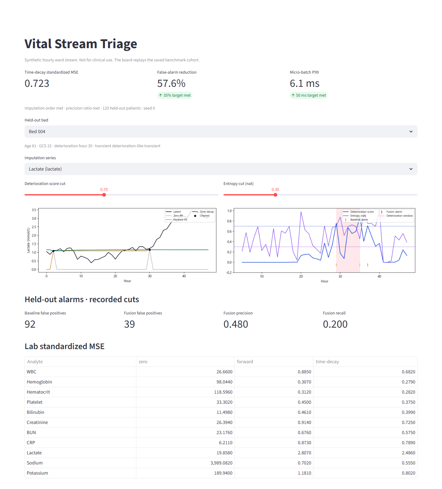

# vital-stream-triage

Synthetic benchmark for three questions about an hourly ward stream: how to fill a lab that is drawn once or twice a day, whether a deterioration score above 0.7 should stay silent when the class distribution is flat, and whether one CPU thread can finish a 1,000-bed arrival inside 50 ms at P99.

The suite does not read a hospital extract and it is not a clinical device. Numbers in [BENCHMARK_RESULTS.md](BENCHMARK_RESULTS.md) are one CPU run. [docs/PRD.md](docs/PRD.md) states the product requirements. [docs/TECHNICAL_REPORT.md](docs/TECHNICAL_REPORT.md) records what the code implements and which published methods it does not run. [docs/PAPER.md](docs/PAPER.md) is the technical note for that same run.

## Demo

`streamlit run app.py` opens a local board on `http://127.0.0.1:8503`. The metric cards are the recorded run. The bed selector and the two cuts recompute alarms on the saved held-out cohort.



The frame is the default operating point: time-decay standardized MSE 0.723, false-alarm reduction 57.6%, micro-batch P99 6.1 ms. Moving either slider recomputes the held-out counts under the board.

## Channels

Six high-frequency vitals: systolic blood pressure, diastolic blood pressure, heart rate, respiratory rate, temperature, SpO2.

Eleven low-frequency labs: WBC, hemoglobin, hematocrit, platelet count, bilirubin, creatinine, BUN, CRP, lactate, sodium, potassium. Hematocrit, BUN, sodium, and potassium are routine chemistries that complete the panel.

Two static fields: age and GCS.

The grid is hourly. Two blood panels in 48 hours leave each lab missing on more than 90% of the grid. This is not a 1 Hz monitor waveform.

Time-decay returns toward the population mean:

$$
\hat{x}(t) = \mu + (x_{\mathrm{last}} - \mu)\, \exp(-\Delta t / \tau)
$$

$\tau$ is a fixed freshness constant per analyte and matches the generator's Ornstein–Uhlenbeck time constant. It is not fit on hospital data.

## Experiments

| Experiment | Comparison | Target |
| --- | --- | --- |
| Imputation | zero-fill, forward-fill, time-decay | lowest standardized MSE, and distance from the last draw grows with elapsed time |
| Alarms | deteriorate softmax $> 0.7$ versus that rule and entropy $< 0.3$ nats | at least 35% fewer false alarms, precision at least as high |
| Serving | batch 1 versus micro-batch on the same queue | P99 under 50 ms for 1,000 beds on one CPU thread |

Entropy is one 3-class softmax,

$$
H(p) = -\sum_k p_k \ln p_k.
$$

$H < 0.3$ nats admits only a sharply peaked distribution, so it is a stricter confidence cut than a score of 0.7. It is not MC dropout. The three classes are stable, transient, and deteriorate. A transient hour is a short heart-rate and respiratory spike, or a deterioration-like shift that ends before the event window. Only deteriorate is the positive label.

A deteriorate probability of 0.75 does not pass the fusion rule. For $p = (0.10, 0.15, 0.75)$,

$$
H(p) \approx 0.73
$$

nats, which is above 0.3. On the recorded run the lowest fusion score is 0.928.

Each scored hour is a window of shape $(28, 6)$: 17 imputed channels and 11 lab-staleness channels, from that hour back five hours. Age and GCS are a separate vector of length 2. Micro-batch 128 is one forward of those windows on one CPU thread. The 48-hour stay is not packed as a tensor of shape $(19, 48)$.

The deterioration label covers the six hours before the event and stops at the event hour. Hours after the event are excluded from the alarm counts. Alarm metrics use the held-out 30% of patients. Vitals are present on 96% of hours. The 4% vital gaps are independent draws, not a four-hour or eight-hour nursing round.

## Run

Python 3.10+ and `requirements.txt`. CPU is enough.

```bash
python -m pip install -r requirements.txt
python -m vital_triage.runner --synthetic
streamlit run app.py
```

The runner stops unless `--synthetic` is set. Defaults: 400 patients, 48 hours, 20 epochs, 1,000 beds, micro-batch 128, seed 0.

On that default run the 11-lab standardized MSE was 412.978 (zero-fill), 0.870 (forward-fill), and 0.723 (time-decay). Time-decay was lower on every lab. Lactate was 19.858, 2.807, and 2.486: same order, largest residual, because a rise between draws is in neither $x_{\mathrm{last}}$ nor $\mu$.

On the same run the entropy gate cut false positives from 92 to 39 (57.6%). Precision rose from 0.352 to 0.480. Recall fell from 0.278 to 0.200. The 67 dropped hours are 14 true positives and 53 false positives. A page-versus-watchlist split for those 67 hours is specified in the product requirements and is not implemented. The 1,000-bed P99 was 188.68 ms sequential and 6.10 ms micro-batch, with throughput 5,253.9 versus 163,580.4 beds/s (31.1×). Latency moves slightly on a repeat; imputation error and alarm counts stay put at the same seed. Triton dynamic batching and FHIR reads were not executed.

Primary sources are Che et al., GRU-D, *Sci Rep* 2018; the PhysioNet/CinC Challenge 2019 (Reyna et al., *Crit Care Med* 2020); Sendelbach and Funk, *AACN Adv Crit Care* 2013; and Ovadia et al., NeurIPS 2019. The technical report keeps each of those numbers separate from this repository. Ovadia et al. show that softmax confidence is often overconfident under dataset shift. This entropy cut was not tested under a shift.

## Layout

```text
vital_triage/            generator, decay buffer, 1D head, alarms, runner
app.py                   bed curves and alarm sliders
docs/PRD.md              product requirements
docs/TECHNICAL_REPORT.md
docs/PAPER.md            technical note
docs/figures/            dashboard frame
```
